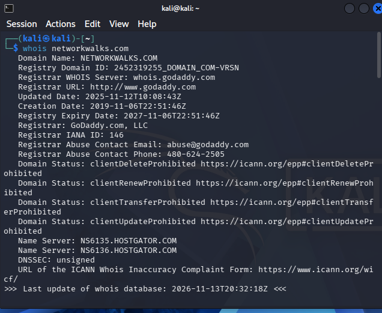
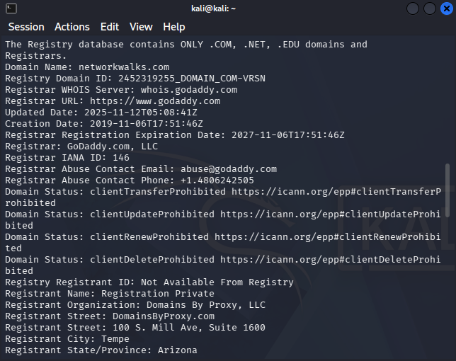
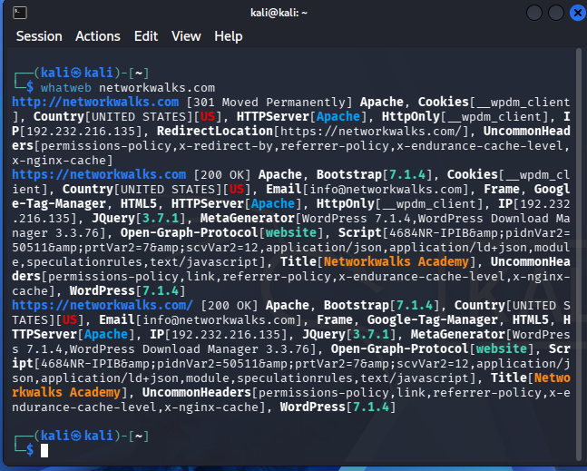
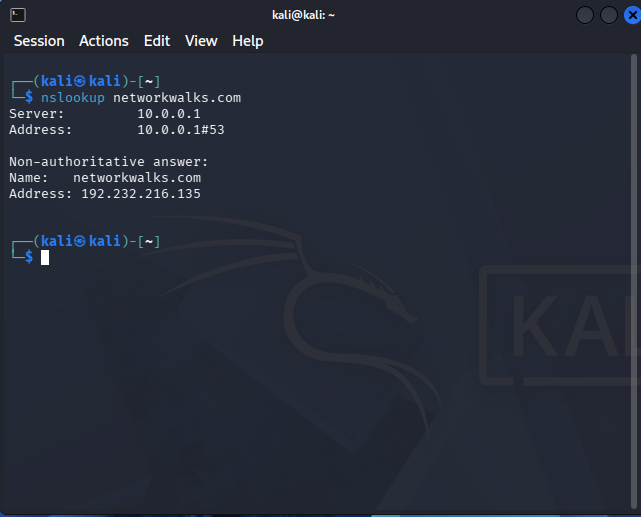
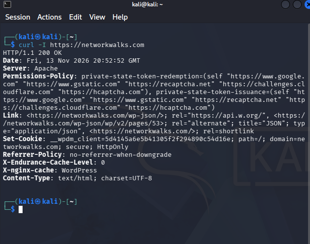
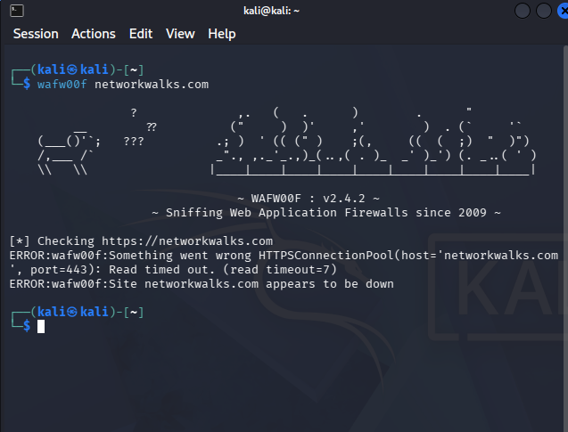
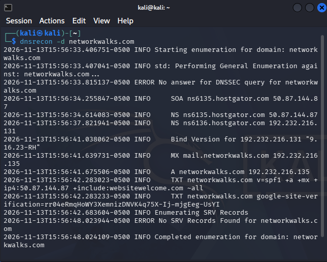

# 🔐 Penetration Testing Report — Footprinting & Network Scanning Phases


> **Official Assessment Deliverable (`W2-PM-FINAL`)** — Practical reconnaissance, web stack fingerprinting, DNS enumeration, and local subnet discovery conducted as part of the **Networkwalks Cybersecurity & Ethical Hacking Internship (Batch B084)**.

---

## ⚠️ Legal & Liability Disclaimer

> **IMPORTANT — AUTHORIZED EDUCATIONAL & RESEARCH USE ONLY**
>
> All security assessments documented in this repository were executed **strictly** against systems where explicit written authorization was secured (`networkwalks.com`) or private infrastructure owned directly by the tester (`192.168.1.0/24`).
>
> * Do **not** use the commands, methodologies, or findings in this repository to test, scan, or access systems without prior written permission from the asset owner.
> * The author, instructors, and **Networkwalks** assume no liability for misuse of this information. Unauthorized access to computer systems is a criminal offense in most jurisdictions, even when no damage occurs.

---

## 📌 Engagement & Project Information

| Attribute | Details |
| :--- | :--- |
| **Pentester Name** | Islam Tamer Soliman Allam |
| **Program / Batch** | `B084` — Networkwalks Cybersecurity & Ethical Hacking Internship |
| **Report Identifier** | `W2-PM-FINAL` — [Download Full DOCX Report](W2-PM-FINAL-Penetration-Testing-Report-Islam.docx) |
| **Modules Completed** | `W2-PM1` (Kali Linux Recon Suite) & `W2-PM5` (Zenmap Network Scanning) |
| **Assessment Date** | 13 November 2026 |
| **Target 1 (External)** | `networkwalks.com` *(Written permission secured)* |
| **Target 2 (Internal)** | `192.168.1.0/24` *(Tester-owned Local Area Network)* |
| **Raw Terminal Logs** | [My Pentest result.txt](<My Pentest result.txt>) |
| **Topology Diagram** | [zenmap.pdf](zenmap.pdf) |
| **Phases Covered** | ✅ Phase 1: Reconnaissance & Footprinting<br>✅ Phase 2: Scanning & Network Discovery<br>⏳ Phases 3–5: Vulnerability Analysis, Exploitation & Post-Exploitation *(In Progress)* |

---

## 📖 1. Executive Summary & Introduction

This repository documents the Week 2 practical penetration testing assessment (`W2-PM-FINAL`), bridging external passive/active intelligence gathering with internal network host discovery:

1. **Footprinting & Reconnaissance (`W2-PM1`):** Executed six industry-standard Kali Linux reconnaissance utilities (`whois`, `whatweb`, `nslookup`, `curl`, `wafw00f`, and `dnsrecon`) against `networkwalks.com` to map domain ownership, authoritative DNS infrastructure, hosting location, web server headers, and CMS/plugin versions.
2. **Network Scanning & Discovery (`W2-PM5`):** Utilized Windows Command Prompt (`ipconfig`) and **Zenmap** (Nmap GUI) to enumerate live hosts, hardware MAC addresses, and physical/logical topology across the `192.168.1.0/24` local subnet.

**Key Assessment Takeaways:**
* **0 Critical / High** immediate exposures identified during non-intrusive discovery.
* **2 Medium** informational/configuration findings (CMS/plugin version disclosure and unsigned DNSSEC with exposed BIND daemon version).
* **4 Low** informational observations (origin IP visibility, verbose HTTP/REST API headers, HTTPS probe timeout behavior, and local host discoverability).

---

## 🎯 2. Scope & Rules of Engagement

| Target Asset | Scope Type | Authorization Status | Permitted Activities | Prohibited Activities |
| :--- | :--- | :--- | :--- | :--- |
| `networkwalks.com` (`192.232.216.135`) | External Domain & Web Application | Written Permission Secured | Passive OSINT, WHOIS, DNS queries, HTTP header inspection, non-intrusive WAF checks | Denial of Service (DoS), brute-force attacks, exploitation, data modification |
| `192.168.1.0/24` | Internal Local Subnet (LAN) | Self-Owned Lab Environment | ICMP/ARP host discovery (`-sn`), MAC address collection, topology mapping | Scanning external ISP gateways or third-party networks |

---

## 🛠️ 3. Tools & Environment Used

| Tool / Platform | Environment | Command Used | Security Purpose |
| :--- | :--- | :--- | :--- |
| **Kali Linux & Windows** | Host / VM Lab | — | Dual-OS testing setup for external reconnaissance and internal LAN discovery |
| **WHOIS** | Kali Linux | `whois networkwalks.com` | Retrieve registrar details, registration/expiry dates, privacy proxy, EPP status, and name servers |
| **WhatWeb** | Kali Linux | `whatweb networkwalks.com` | Fingerprint web server, CMS version, plugins, JavaScript libraries, cookies, and contact emails |
| **nslookup** | Kali Linux | `nslookup networkwalks.com` | Resolve domain FQDN to its hosting IPv4 address via local DNS resolver |
| **cURL** | Kali Linux | `curl -I https://networkwalks.com` | Inspect raw HTTP/1.1 response headers, cache layers, cookie flags, and API link headers |
| **WAFW00F** | Kali Linux | `wafw00f networkwalks.com` | Probe for active Web Application Firewall (WAF) signatures and rate-limiting behavior |
| **DNSRecon** | Kali Linux | `dnsrecon -d networkwalks.com` | Enumerate SOA, NS, A, MX, TXT/SPF, SRV records, DNSSEC status, and BIND version banners |
| **Zenmap (Nmap GUI)** | Windows PC | `nmap -sn 192.168.1.0/24` | Perform ping sweep across the local `/24` subnet, identify live hosts, MACs, and export topology |
| **Windows CMD** | Windows PC | `ipconfig` / `ipconfig /all` | Verify local interface IPv4 address, subnet mask, default gateway, and physical MAC address |

---

## 🔍 4. Methodology & Technical Walkthrough

### 4.1 Phase 1 — Footprinting & Reconnaissance (`W2-PM1`)

#### 1️⃣ Domain Registration Intelligence (`whois`)
* **Command:**
  ```bash
  whois networkwalks.com
  ```
* **Key Findings:**
  * **Registrar:** GoDaddy.com, LLC (IANA ID: `146`)
  * **Timeline:** Created `2019-11-06` | Updated `2025-11-12` | Expires `2027-11-06`
  * **Registrant Privacy:** Protected via *Domains By Proxy, LLC* (Tempe, Arizona)
  * **Domain Locks:** `clientDeleteProhibited`, `clientRenewProhibited`, `clientTransferProhibited`, `clientUpdateProhibited`
  * **Authoritative Name Servers:** `NS6135.HOSTGATOR.COM` & `NS6136.HOSTGATOR.COM`
  * **DNSSEC Status:** `unsigned`
* **Security Significance:** While registrant PII is shielded by privacy proxy and domain transfer locks are properly enabled, `DNSSEC: unsigned` leaves DNS responses without cryptographic authentication.




---

#### 2️⃣ Web Technology Fingerprinting (`whatweb`)
* **Command:**
  ```bash
  whatweb networkwalks.com
  ```
* **Observed Output Summary:**
  ```text
  [http://networkwalks.com](http://networkwalks.com) [301 Moved Permanently] -> [https://networkwalks.com/](https://networkwalks.com/) [200 OK]
  IP: 192.232.216.135 | Country: UNITED STATES [US]
  HTTPServer: Apache | CMS: WordPress [7.1.4]
  Plugins/Libs: WordPress Download Manager [3.3.76], Bootstrap [7.1.4], jQuery [3.7.1], Google-Tag-Manager
  Cookies: __wpdm_client (HttpOnly) | Email: info@networkwalks.com
  ```
* **Security Significance:** Exposing exact version strings (`WordPress 7.1.4`, `WordPress Download Manager 3.3.76`) allows threat actors to map the stack directly against public CVE advisories without sending intrusive payloads.



---

#### 3️⃣ DNS Name Resolution (`nslookup`)
* **Command:**
  ```bash
  nslookup networkwalks.com
  ```
* **Observed Output:**
  ```text
  Server:         10.0.0.1
  Address:        10.0.0.1#53

  Non-authoritative answer:
  Name:   networkwalks.com
  Address: 192.232.216.135
  ```
* **Security Significance:** Confirms `networkwalks.com` resolves directly to origin IPv4 `192.232.216.135` rather than an anycast CDN reverse proxy, meaning traffic reaches the hosting server directly.



---

#### 4️⃣ HTTP Response Header Inspection (`curl`)
* **Command:**
  ```bash
  curl -I [https://networkwalks.com](https://networkwalks.com)
  ```
* **Observed Output:**
  ```http
  HTTP/1.1 200 OK
  Date: Fri, 13 Nov 2026 20:52:52 GMT
  Server: Apache
  Permissions-Policy: private-state-token-redemption=(self ...), private-state-token-issuance=(self ...)
  Link: [https://networkwalks.com/wp-json/](https://networkwalks.com/wp-json/); rel="[https://api.w.org/](https://api.w.org/)", [https://networkwalks.com/wp-json/wp/v2/pages/53](https://networkwalks.com/wp-json/wp/v2/pages/53); rel="alternate"; title="JSON"; type="application/json", [https://networkwalks.com/](https://networkwalks.com/); rel=shortlink
  Set-Cookie: __wpdm_client=5d4145a6e5b41305f2f294890c54d16e; path=/; domain=networkwalks.com; secure; HttpOnly
  Referrer-Policy: no-referrer-when-downgrade
  X-Endurance-Cache-Level: 0
  X-nginx-cache: WordPress
  Content-Type: text/html; charset=UTF-8
  ```
* **Security Significance:**
  * **Positive Controls:** Session cookie `__wpdm_client` enforces both `secure` and `HttpOnly` flags; `Permissions-Policy` and `Referrer-Policy` headers are present.
  * **Exposure:** Advertises the `Server: Apache` banner, HostGator Endurance caching (`X-Endurance-Cache-Level`), and publicly exposes the `/wp-json/` WordPress REST API endpoint.



---

#### 5️⃣ Web Application Firewall Detection (`wafw00f`)
* **Command:**
  ```bash
  wafw00f networkwalks.com
  ```
* **Observed Output:**
  ```text
  [*] Checking [https://networkwalks.com](https://networkwalks.com)
  ERROR:wafw00f:Something went wrong HTTPSConnectionPool(host='networkwalks.com', port=443): Read timed out. (read timeout=7)
  ERROR:wafw00f:Site networkwalks.com appears to be down
  ```
* **Security Significance:** While `curl` received an immediate `200 OK`, `wafw00f`'s multi-request fingerprinting probes timed out after 7 seconds on TCP port `443`. This indicates active connection throttling, rate-limiting, or perimeter filtering against automated WAF scanner signatures.



---

#### 6️⃣ Comprehensive DNS Enumeration (`dnsrecon`)
* **Command:**
  ```bash
  dnsrecon -d networkwalks.com
  ```
* **Enumerated Records:**

| Record Type | Host / Name | Value / Target IP | Notes |
| :--- | :--- | :--- | :--- |
| **SOA** | `networkwalks.com` | `ns6135.hostgator.com` (`50.87.144.87`) | Primary Start of Authority |
| **NS** | `networkwalks.com` | `ns6135.hostgator.com` (`50.87.144.87`) | HostGator Primary Name Server |
| **NS** | `networkwalks.com` | `ns6136.hostgator.com` (`192.232.216.131`) | Exposes `Bind Version: "9.16.23-RH"` |
| **A** | `networkwalks.com` | `192.232.216.135` | Primary Web Server |
| **MX** | `networkwalks.com` | `mail.networkwalks.com` (`192.232.216.135`) | Co-located on web server IP |
| **TXT (SPF)** | `networkwalks.com` | `v=spf1 +a +mx +ip4:50.87.144.87 +include:websitewelcome.com ~all` | SoftFail (`~all`) policy configured |
| **TXT** | `networkwalks.com` | `google-site-verification=rr04eRmqHoWY3XemnizDNVK4q75X-Ij-mjgEeg-UsYI` | Domain ownership verification |
| **DNSSEC / SRV** | `networkwalks.com` | *None Returned* | DNSSEC unsigned; no SRV records |

* **Security Significance:** Reveals mail co-location (`mail.networkwalks.com` shares `192.232.216.135`), discloses the exact DNS daemon version (`Bind 9.16.23-RH` on `192.232.216.131`), and confirms lack of DNSSEC signing.



---

### 4.2 Phase 2 — Network Scanning & Discovery (`W2-PM5`)

1. **Local Interface Verification (`ipconfig` / `ipconfig /all`):**
   * Identified active local LAN subnet: `192.168.1.0/24`
   * Testing Host (Windows PC) IPv4: `192.168.1.105`
   * Default Gateway IPv4: `192.168.1.1`
2. **Zenmap Host Discovery Ping Scan:**
   ```bash
   nmap -sn 192.168.1.0/24
   ```
   * **Discovered Live Hosts (2 Active Nodes):**
     * `192.168.1.1` — Local Default Gateway / Router *(MAC address captured via Zenmap Nmap Output tab)*
     * `192.168.1.105` — Local Windows Testing Workstation *(Physical MAC verified via `ipconfig /all`)*
3. **Topology Mapping & Export:**
   * Generated visual network graph inside Zenmap's **Topology** tab linking `localhost` (`192.168.1.105`) and the gateway (`192.168.1.1`) with legend enabled, and exported the diagram to PDF: **[View Zenmap Topology PDF](zenmap.pdf)**

---

## 📊 5. Risk Analysis & Findings Matrix

> **Note:** All findings below reflect non-intrusive reconnaissance and host discovery observations. No exploitation or intrusive vulnerability scanning was performed during Week 2.

| ID | Finding Title | Target | Evidence / Observation | Potential Security Impact | Risk Level |
| :-: | :--- | :--- | :--- | :--- | :---: |
| **F-01** | **Web Technology & Plugin Version Disclosure** | `networkwalks.com` | `whatweb` identified `WordPress 7.1.4`, `WordPress Download Manager 3.3.76`, `Bootstrap 7.1.4`, and `jQuery 3.7.1` | Allows attackers to cross-reference exact CMS/plugin versions against CVE databases to identify known exploits | 🟠 **Medium** |
| **F-02** | **DNS Daemon Version Banner & Unsigned DNSSEC** | `ns6136.hostgator.com` / `networkwalks.com` | `dnsrecon` exposed `Bind 9.16.23-RH` on `192.232.216.131` and `whois`/`dnsrecon` confirmed unsigned DNSSEC | Exposes specific BIND release metadata and leaves DNS queries vulnerable to cache poisoning / spoofing | 🟠 **Medium** |
| **F-03** | **Direct Origin Server & Mail IP Exposure** | `192.232.216.135` | `nslookup` and `dnsrecon` resolved both `networkwalks.com` and `mail.networkwalks.com` to `192.232.216.135` | Reveals underlying hosting provider (HostGator) and permits direct-to-origin traffic bypassing edge filtering | 🟡 **Low** |
| **F-04** | **HTTP Server Banner & WordPress REST API Exposure** | `https://networkwalks.com` | `curl -I` returned `Server: Apache`, `X-nginx-cache: WordPress`, and `Link: </wp-json/>` | Assists in stack fingerprinting and unauthenticated endpoint/author enumeration via REST API | 🟡 **Low** |
| **F-05** | **HTTPS Probe Timeout / Filtering Behavior** | `networkwalks.com:443` | `wafw00f` timed out (`Read timed out=7`) while `curl -I` succeeded | Indicates active perimeter throttling against automated probes, though WAF vendor identification was inconclusive | 🟡 **Low** |
| **F-06** | **Local Subnet Hosts & MACs Discoverable via ICMP/ARP** | `192.168.1.0/24` | `nmap -sn` enumerated `192.168.1.1` and `192.168.1.105` with Layer-2 MAC addresses | Unmonitored LAN segments allow rogue or unauthorized devices to join undetected without periodic inventory audits | 🟡 **Low** |

**Severity Key:** 🔴 Critical | 🟠 Medium | 🟡 Low

---

## 🛡️ 6. Remediation & Hardening Recommendations

### 1. Suppress WordPress & Plugin Version Metadata (`F-01`)
Remove generator meta tags and query-string version parameters in WordPress `functions.php`:
```php
remove_action('wp_head', 'wp_generator');
add_filter('the_generator', '__return_empty_string');

function remove_wp_version_strings($src) {
    if (strpos($src, 'ver=')) {
        $src = remove_query_arg('ver', $src);
    }
    return $src;
}
add_filter('style_loader_src', 'remove_wp_version_strings', 9999);
add_filter('script_loader_src', 'remove_wp_version_strings', 9999);
```

### 2. Minimize Apache & BIND Version Banners (`F-02`, `F-04`)
* **Apache (`httpd.conf` / `security.conf`):**
  ```apache
  ServerTokens Prod
  ServerSignature Off
  Header always unset X-Powered-By
  ```
* **BIND DNS (`named.conf.options`):**
  ```text
  options {
      version "none";
  };
  ```

### 3. Restrict Unauthenticated WordPress REST API Enumeration (`F-04`)
```php
add_filter('rest_authentication_errors', function ($result) {
    if (!empty($result)) {
        return $result;
    }
    if (!is_user_logged_in()) {
        return new WP_Error('rest_not_logged_in', 'REST API restricted to authenticated users.', array('status' => 401));
    }
    return $result;
});
```

### 4. Enable DNSSEC & Tighten SPF Policy (`F-02`)
* Enable **DNSSEC** at the DNS host (HostGator) and publish the DS record at the domain registrar (GoDaddy).
* Once all legitimate mail senders are verified, transition the SPF record from SoftFail (`~all`) to HardFail (`-all`) and configure **DMARC** (`p=quarantine` or `p=reject`).

### 5. Periodic Local Network Asset Auditing (`F-06`)
```bash
nmap -sn 192.168.1.0/24 -oX baseline_lan.xml
nmap -sn 192.168.1.0/24 -oX current_lan.xml
ndiff baseline_lan.xml current_lan.xml
```

---

## 🗓️ 7. Assessment Roadmap (Phases 3–5)

* [x] **Phase 1:** Passive & Active Footprinting (`whois`, `whatweb`, `nslookup`, `curl`, `wafw00f`, `dnsrecon`)
* [x] **Phase 2:** Host Discovery & Network Topology Mapping (`ipconfig`, `Zenmap / Nmap`)
* [ ] **Phase 3:** Port & Service Enumeration + Vulnerability Assessment *(Authorized target scope)*
* [ ] **Phase 4:** Controlled Vulnerability Verification & Exploitation Analysis
* [ ] **Phase 5:** Post-Exploitation Review & Final Executive Deliverable

---

## 👨‍💻 Author & Acknowledgments

* **Author:** Islam Tamer Soliman Allam — Cybersecurity Professional *(Batch B084)*
* **Training & Mentorship:** [Networkwalks Academy](https://networkwalks.com)
* **License:** Shared under the MIT License for authorized educational and defensive security research.
